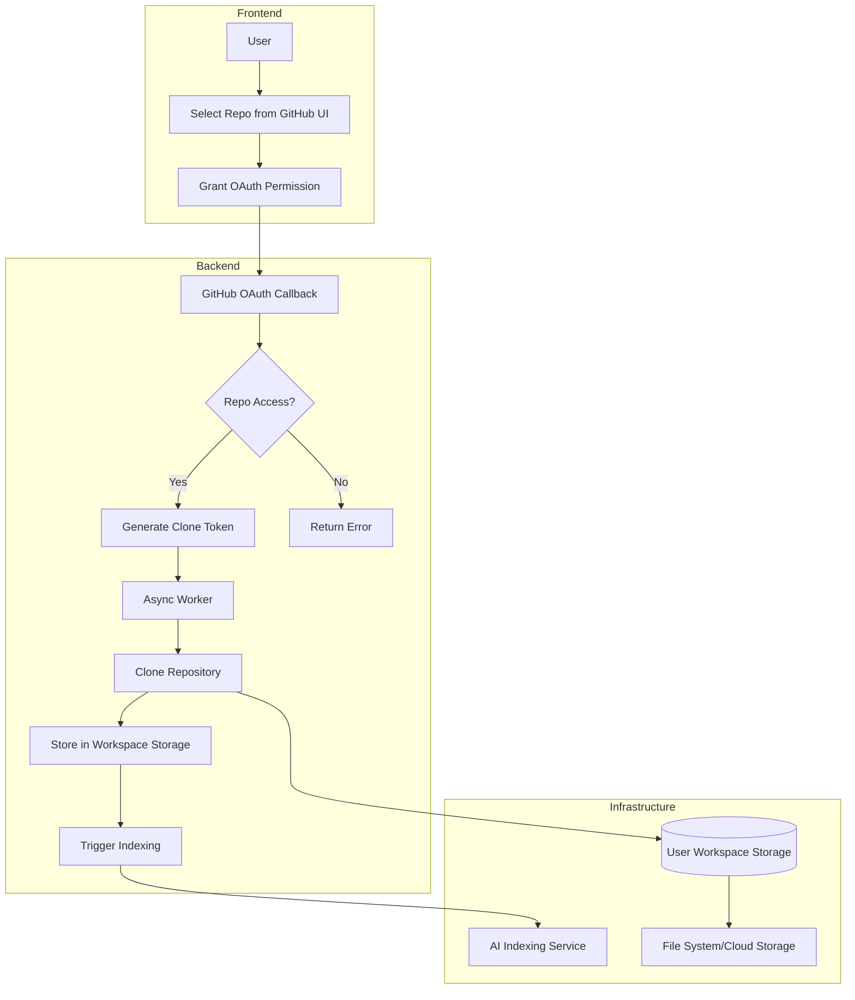

# Polonium Architecture

## Product Philosophy

**Think of Polonium as a pipeline, not a single app.**

```
User → Workspace → Repo → Intelligence → Collaboration → Memory → Updates
```

## Pipeline Flow

### 1️⃣ Entry Flow (User → Platform)
**Purpose**: Get users in with minimum friction.

**Flow**:
- User opens platform
- Chooses:
  - Sign up (Email / GitHub)
  - Or View public workspace (read-only)
- Backend creates user session
- User lands on dashboard

**Result**: User identity is established (No repo access yet)

---

### 2️⃣ Workspace Creation Flow (Platform → Workspace)
**Purpose**: Everything happens inside a workspace.

**Flow**:
- User clicks "Create Workspace"
- Chooses:
  - Public repo
  - Private repo (if authorized)
- Selects default branch (main)
- Workspace record created
- Members invited (optional)

**Result**: A shared AI context is created

---

### 3️⃣ Repo Connection Flow (Workspace → Repo)
**Purpose**: Attach code to the workspace.

**Flow**:
- Backend verifies repo access
- Fetch repo metadata:
  - branches
  - default branch
  - languages
- Store repo reference
- Mark workspace as "connected"

**Result**: Workspace now knows which code it owns

**Detailed Flow Diagram**:



---

### 4️⃣ Repo Ingestion Flow (Repo → Knowledge)
**Purpose**: Turn code into AI-readable knowledge.

**Flow**:
- Fetch repo tree (API or clone)
- Filter files (ignore binaries, deps)
- Chunk files (functions/classes)
- Generate embeddings
- Store in vector DB
- Generate repo overview
- Save to workspace memory

**Result**: Repo becomes queryable by AI

---

### 5️⃣ Repo Understanding Flow (User ↔ AI)
**Purpose**: Help developers understand the code.

**User Actions**:
- Ask questions
- Open files
- Explore branches

**AI Flow**:
- User asks question
- Retrieve relevant code + memory
- Inject branch context
- LLM generates answer
- Answer saved to history

**Result**: AI gives context-aware answers

---

### 6️⃣ Collaboration Flow (Multi-User + AI)
**Purpose**: Make understanding shared.

**Flow**:
- Users join workspace
- Real-time chat starts
- Messages broadcast via WebSockets
- AI responses visible to all
- Presence updated live

**Result**: Team + AI work together

---

### 7️⃣ Persistent Memory Flow (Your Differentiator)
**Purpose**: Never lose knowledge.

**Flow**:
- AI detects important info
- Classifies as:
  - decision
  - explanation
  - known issue
- Saves to repo memory
- Embeds memory
- Reuses in future answers

**Result**: Workspace gets smarter over time

---

### 8️⃣ Branch & Change Analysis Flow
**Purpose**: Understand evolution of the code.

**Flow**:
- Fetch branches & commits
- Track active vs stale branches
- Analyze diffs
- Explain changes in natural language

**Result**: AI understands code history

---

### 9️⃣ Sync & Update Flow (GitHub → Workspace)
**Purpose**: Keep workspace up-to-date.

**Flow**:
- GitHub webhook triggered
- Identify changed branch/files
- Re-index only changed files
- Update embeddings & memory
- Notify workspace users

**Result**: Live, accurate repo knowledge

---

### 🔟 Exit Flow (Contribution Support)
**Purpose**: Turn understanding into action.

**Flow**:
- User picks an issue
- AI suggests:
  - files to read
  - branch to use
  - difficulty level
- User contributes via GitHub
- Workspace stays updated

**Result**: Understanding becomes contribution

---

## System Architecture

```
┌─────────────────┐
│   Next.js UI    │  (Frontend)
└────────┬────────┘
         │ HTTP/WebSocket
         ▼
┌─────────────────────────────────────────┐
│         FastAPI Backend                 │
│  ┌───────────────────────────────────┐  │
│  │  API Routes (REST + WebSocket)    │  │
│  └───────────┬───────────────────────┘  │
│              │                           │
│  ┌───────────▼───────────────────────┐  │
│  │      Service Layer                │  │
│  │  - GitHub Service                 │  │
│  │  - Repo Ingestion Service         │  │
│  │  - AI Service (LLM)               │  │
│  │  - Embedding Service              │  │
│  │  - Memory Service                 │  │
│  │  - Workspace Service              │  │
│  │  - Branch Analysis Service        │  │
│  └───────────┬───────────────────────┘  │
│              │                           │
└──────────────┼───────────────────────────┘
               │
    ┌──────────┼──────────┐
    │          │          │
    ▼          ▼          ▼
┌─────────┐ ┌──────┐ ┌─────────┐
│PostgreSQL│ │Qdrant│ │  Redis  │
│  (Core)  │ │(Vec) │ │ (Cache) │
└─────────┘ └──────┘ └─────────┘
```

## Core Data Models

### User
- Authentication (GitHub OAuth / Email)
- Session management
- Workspace memberships

### Workspace
- Shared AI context container
- Members (users with access)
- Repository associations
- Default branch settings
- Visibility (public/private)

### Repository
- GitHub repo metadata (owner, name, URL)
- Workspace association
- Ingestion status and timestamps
- Branch tracking
- Configuration settings

### File
- File path and content
- File type and language
- Embedding reference (Qdrant ID)
- Branch association
- Metadata (size, last modified)

### ChatMessage
- Workspace association
- Repository context
- User information
- Message content and timestamp
- AI response context
- Branch context

### RepositoryMemory
- Workspace association
- Repository association
- Memory chunks (key insights, patterns, decisions)
- Memory classification (decision/explanation/issue)
- Embeddings for memory retrieval
- Timestamps and versioning

### Branch
- Repository association
- Branch name and SHA
- Commit history
- Active/stale status
- Diff analysis

## API Design

### REST Endpoints

#### Workspace Management
- `POST /api/v1/workspaces` - Create workspace
- `GET /api/v1/workspaces` - List user's workspaces
- `GET /api/v1/workspaces/{workspace_id}` - Get workspace details
- `POST /api/v1/workspaces/{workspace_id}/members` - Invite members
- `DELETE /api/v1/workspaces/{workspace_id}/members/{user_id}` - Remove member

#### Repository Management
- `POST /api/v1/workspaces/{workspace_id}/repositories` - Connect repo to workspace
- `GET /api/v1/workspaces/{workspace_id}/repositories` - List workspace repos
- `GET /api/v1/repositories/{repo_id}` - Get repo details
- `GET /api/v1/repositories/{repo_id}/branches` - List branches
- `GET /api/v1/repositories/{repo_id}/branches/{branch}/diff` - Analyze branch changes

#### Intelligence & Understanding
- `GET /api/v1/repositories/{repo_id}/overview` - Get AI-generated overview
- `GET /api/v1/repositories/{repo_id}/files/{file_path}` - Get file explanation
- `GET /api/v1/repositories/{repo_id}/files/{file_path}?branch={branch}` - Get file from specific branch

#### Collaboration
- `GET /api/v1/workspaces/{workspace_id}/chat` - Get chat history
- `POST /api/v1/workspaces/{workspace_id}/chat` - Send chat message
- `GET /api/v1/workspaces/{workspace_id}/presence` - Get active users

#### Memory
- `GET /api/v1/repositories/{repo_id}/memory` - Get repository memory
- `POST /api/v1/repositories/{repo_id}/memory` - Create memory entry

#### Sync & Updates
- `POST /api/v1/webhooks/github` - GitHub webhook receiver
- `POST /api/v1/repositories/{repo_id}/sync` - Manual sync trigger

### WebSocket
- `ws://api/v1/workspaces/{workspace_id}/chat` - Real-time chat connection
- `ws://api/v1/workspaces/{workspace_id}/presence` - Presence updates

## Security Considerations
- GitHub OAuth for authentication
- Workspace-level access control
- Repository access validation
- Rate limiting on API endpoints
- Input sanitization for file paths
- Secure storage of GitHub tokens
- Webhook signature verification

## Scalability
- Async/await throughout for I/O operations
- Connection pooling for databases
- Caching layer with Redis
- Vector search optimization in Qdrant
- Background job queue for ingestion
- WebSocket connection pooling
- Incremental sync (only changed files)

## Implementation Status

### ✅ Completed
- Repository ingestion pipeline
- AI services (overview, file explanation, chat)
- Basic chat API
- Memory service foundation
- File embedding and vector search

### 🚧 In Progress
- Workspace model and API
- Multi-user collaboration
- Branch analysis
- Webhook integration
- Real-time WebSocket chat

### 📋 Planned
- Public workspace viewing
- Branch diff analysis
- Automatic memory extraction
- Contribution suggestions
- Presence system
