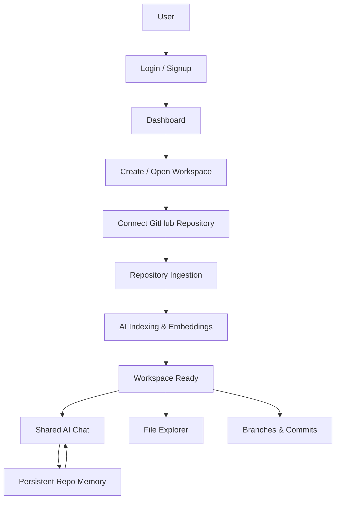
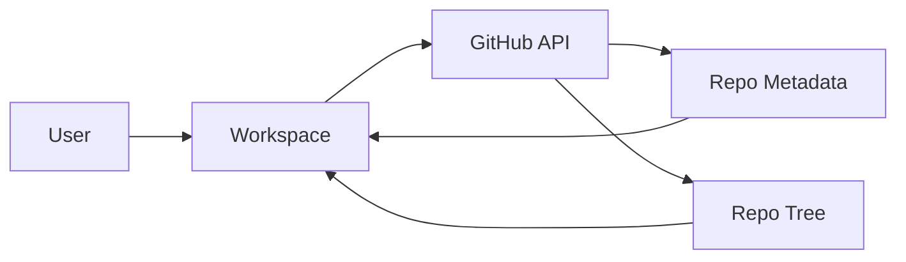
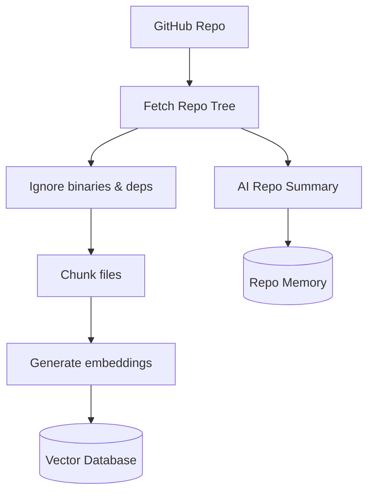
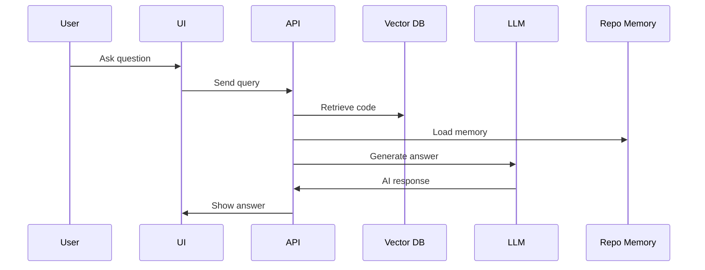
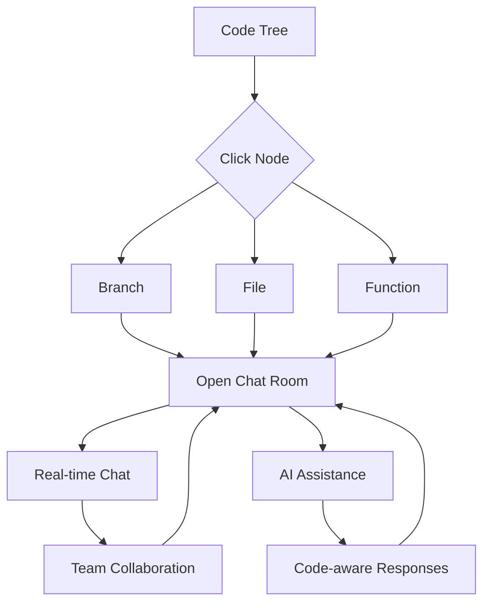
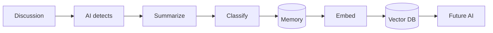
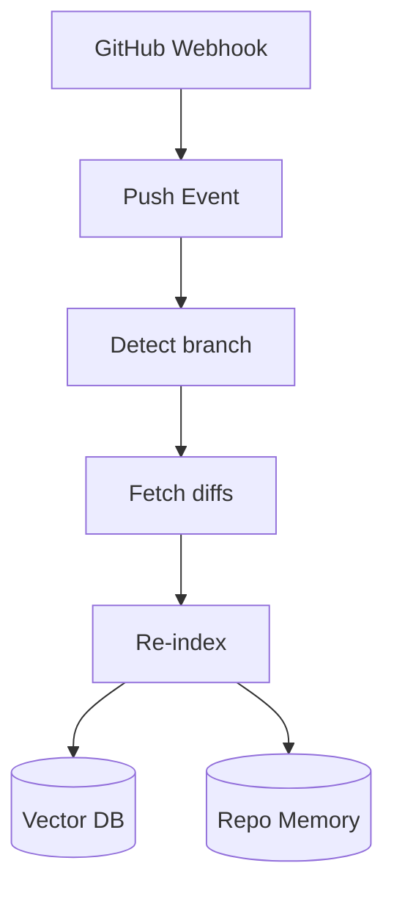
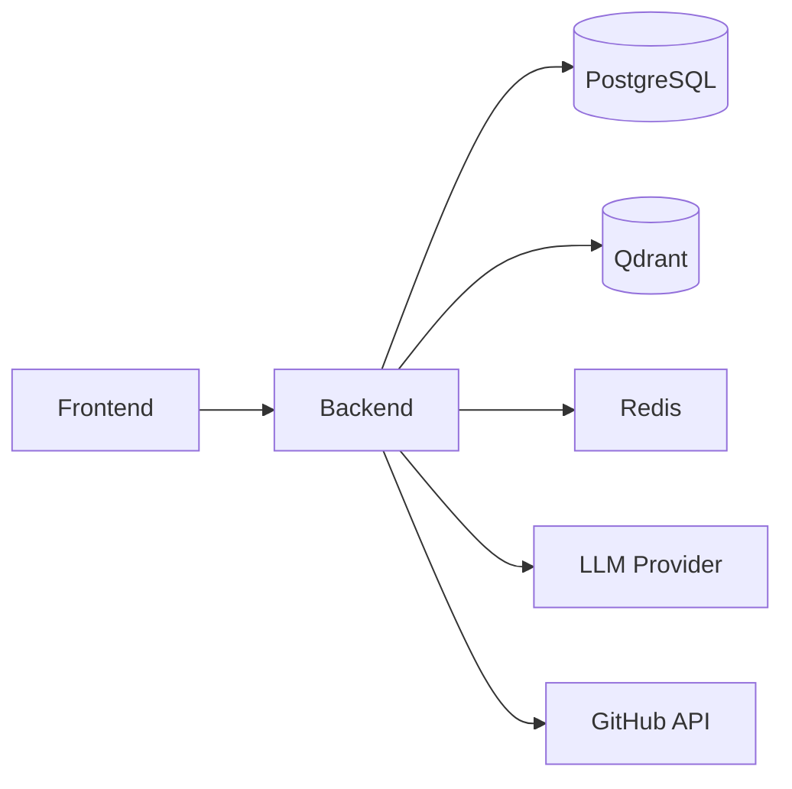

###  Main Product Flow

###  Repository Connection

###  AI Indexing Process

###  AI Q&A (RAG Flow)

###  Real-Time Collaboration

###  Memory Lifecycle

###  Branch Analysis

###  System Architecture

